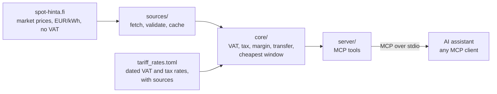

# finland-energy-mcp

[](https://github.com/krathina/finland-energy-mcp/actions/workflows/ci.yml)

An [MCP](https://modelcontextprotocol.io) server that lets any MCP-capable AI assistant answer
**Finnish household electricity questions with real numbers**: for example Claude Desktop and Claude
Code, Cursor, VS Code with GitHub Copilot, Windsurf, or Gemini CLI. MCP is an open standard, so the
server isn't tied to one AI provider.

- *What does electricity really cost me right now?*
- *When is the cheapest time to heat the sauna tonight?*
- *Show me tomorrow's prices by hour.*

Other price tools show the raw market (spot) price. This one shows **what a household actually pays**:
spot price + VAT + retailer margin + network transfer fee + electricity tax, every 15 minutes, with
the user's own contract when they give it.

## Example

> **You:** What does electricity cost right now?
>
> **Assistant** *(calls `get_price_now`)*: Right now (23:00–23:15) about **25.7 c/kWh** incl. VAT:
> spot 18.83 + margin 0.49* + transfer 3.50* + tax 2.92. That's expensive for today (average 18.36).
> \*Example values; tell me your margin and transfer fee and I'll recalculate.
>
> **You:** My margin is 0.39 and my transfer fee is 4.1.
>
> **Assistant** *(calls `get_price_now` with your values)*: With your contract it's **26.2 c/kWh**.
>
> **You:** When's the cheapest 2 hours for the sauna tomorrow evening?
>
> **Assistant** *(calls `find_cheapest_time`, reusing your values)*: 22:00–24:00, averaging 17.9 c/kWh.

## Tools

| Tool | Answers | Inputs |
|---|---|---|
| `get_price_now` | The price right now, split into its parts, with today's low/average/high | optional: your margin and transfer fee |
| `get_prices` | Today's or tomorrow's prices, hourly or every 15 minutes, with the cheapest and dearest times | `day`, `resolution`, optional contract |
| `find_cheapest_time` | The cheapest continuous window for a job, and the extra cost of starting now | `duration_minutes` (multiple of 15), optional `earliest_start`, `finish_by`, `energy_kwh`, contract |

Every answer includes its **assumptions** (data source, VAT, tax, margin and transfer fee, and whether
those came from the user or are example defaults), so the AI can say what it assumed.

## How it works



| Folder | Responsibility |
|---|---|
| `src/finland_energy_mcp/core/` | Pure price logic, no network: 15-minute price series, dated tax rates, household price, cheapest window, fixed vs spot |
| `src/finland_energy_mcp/sources/` | Getting market prices: HTTP client with timeout, error types and a cache that respects the API's rate limit |
| `src/finland_energy_mcp/server/` | The MCP server: tools, output schemas, settings |

Design notes: money is exact `Decimal` (never float); times are stored in UTC and shown in Finnish time
(so clock-change days with 92 or 100 quarter-hours are right); tax rates are data with valid-from dates,
not constants.

## Use it with your AI assistant

Requires [uv](https://docs.astral.sh/uv/) (it provides `uvx`, which downloads and runs the server in
its own isolated environment; nothing to clone or install by hand).

Register it as a local (stdio) MCP server in your assistant. Most clients (Claude Desktop, Cursor,
Windsurf, Gemini CLI and others) use a JSON entry of this shape; see your client's MCP docs for where
the file lives (VS Code uses `servers` instead of `mcpServers`):

```json
{
  "mcpServers": {
    "finland-energy": {
      "command": "uvx",
      "args": ["finland-energy-mcp"]
    }
  }
}
```

With Claude Code it's one command:

```sh
claude mcp add finland-energy -s user -- uvx finland-energy-mcp
```

Restart the assistant, check that `finland-energy` shows 3 tools, and ask away. `uvx` keeps a cached
copy; use `finland-energy-mcp@latest` instead to always get the newest version from
[PyPI](https://pypi.org/project/finland-energy-mcp/).

The server runs locally over stdio. Browser-based assistants that only accept remote MCP servers
(over HTTP) are not supported yet.

## Skill (optional)

[`skills/finland-electricity/`](https://github.com/krathina/finland-energy-mcp/tree/main/skills/finland-electricity)
teaches your assistant to use these tools well: turning "heat the sauna" or "charge the car" into
the right inputs, finding margin and transfer fee on Finnish bills, and stating its assumptions.
It uses the open `SKILL.md` format. For Claude Code, copy the folder into `~/.claude/skills/`.

## Configuration

Optional environment variables, all prefixed `FINLAND_ENERGY_` (full list with defaults in
[`.env.example`](https://github.com/krathina/finland-energy-mcp/blob/main/.env.example)): default margin and transfer fee, VAT on negative prices, the price
API's address, request timeout and cache time. Users can also simply tell the assistant their margin
and transfer fee in the conversation; no configuration needed.

## Development and tests

```sh
git clone https://github.com/krathina/finland-energy-mcp.git
cd finland-energy-mcp
uv sync                  # create the environment with all dependencies
uv run pytest            # offline tests (saved real API responses, fake clock, fake HTTP server)
uv run pytest -m live    # contract tests against the real API and the real server over stdio
uv run ruff check . && uv run ruff format --check . && uv run mypy   # lint, format, strict types
```

Highlights: boundary tests on tax-rate changes (31.3 / 1.4.2026), both clock-change days, negative
prices, a brute-force oracle for the cheapest-window search, the MCP tools called through a real MCP
client in memory, and guard tests that keep tool output names unambiguous and `.env.example` in sync.
CI runs all of it on every push, and the live contract tests nightly.

## Data and sources

- Market prices: [spot-hinta.fi](https://spot-hinta.fi) free API (Nordic day-ahead prices, 15-minute
  periods), which gets them from the [ENTSO-E Transparency Platform](https://transparency.entsoe.eu).
  Its documented limit is one request per minute; the server caches for 15 minutes.
- VAT and electricity tax: [Finnish Tax Administration](https://www.vero.fi), with links per rate in
  [`tariff_rates.toml`](https://github.com/krathina/finland-energy-mcp/blob/main/src/finland_energy_mcp/core/tariff_rates.toml).

## Limitations

- Only today's and tomorrow's prices (tomorrow's appear around 14:00 Finnish time).
- Margin and transfer fee default to example values until the user gives theirs.
- Local (stdio) MCP only for now; a remote (HTTP) mode is planned.
- VAT on negative spot prices is off by default (common Finnish practice; contracts differ).
- Estimates for information, not financial advice.
- Not affiliated with or endorsed by spot-hinta.fi or ENTSO-E.

## License

[MIT](https://github.com/krathina/finland-energy-mcp/blob/main/LICENSE)
